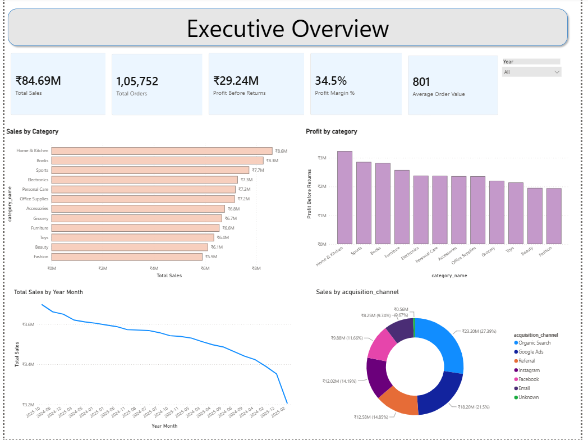
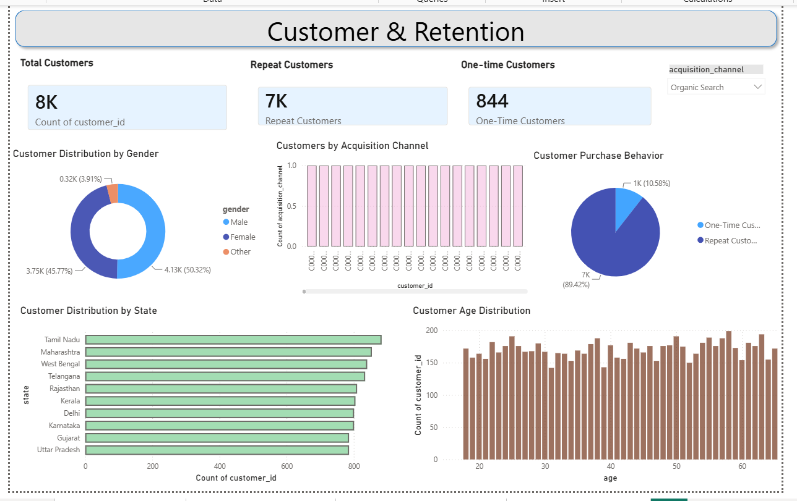
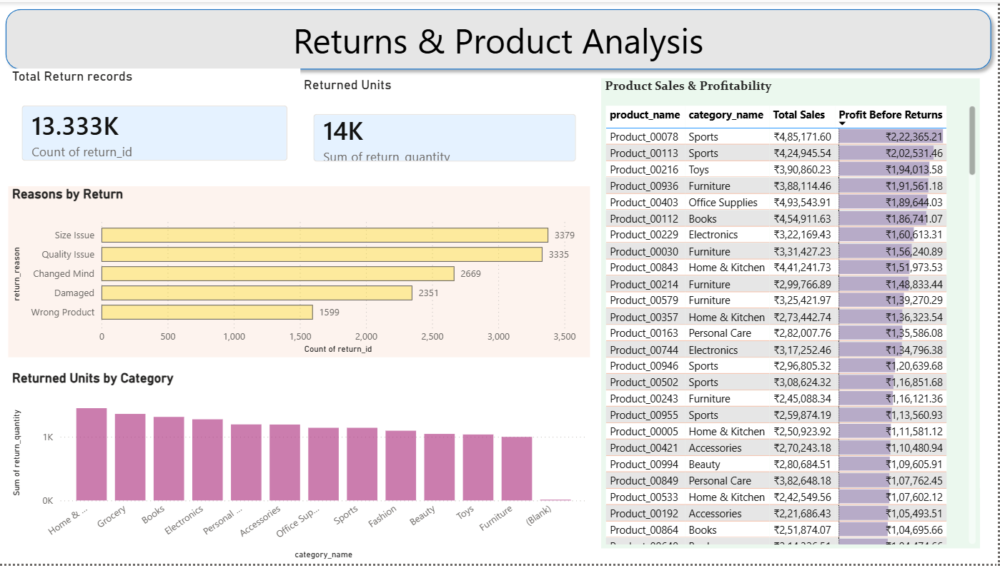
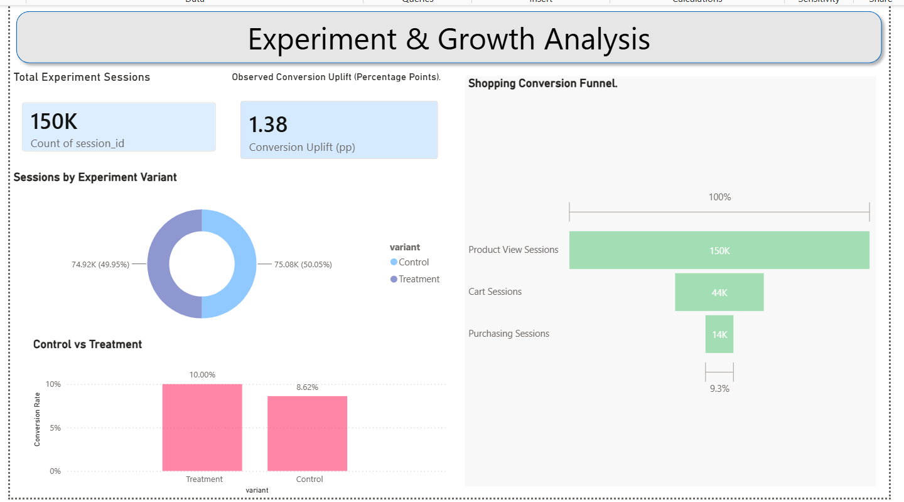

# ShopSphere E-commerce Analytics

An end-to-end e-commerce analytics project using **PostgreSQL, SQL, Python, and Power BI** to analyze sales performance, customer behavior, product profitability, returns, and A/B testing.

> **Note:** ShopSphere is a fictional business, and all project datasets are synthetic. This project demonstrates analytical skills and does not represent real company data or employment experience.

## Project Overview

The goal of this project is to transform e-commerce data into actionable business insights through data cleaning, SQL analysis, Python-based exploratory data analysis, statistical investigation, and interactive Power BI dashboards.

### Business Questions

- Which product categories generate the highest sales and profit?
- Which categories have the strongest and weakest profit margins?
- How do repeat customers contribute to revenue?
- What patterns can be identified in product returns?
- How do conversion rates differ between experiment variants?
- What recommendations can support better business decisions?

## Tools and Technologies

- **PostgreSQL and SQL** — Data quality checks, joins, aggregations, and advanced analysis.
- **Python** — Pandas, NumPy, Matplotlib, and Seaborn.
- **Jupyter Notebook** — Data profiling, exploratory data analysis, and validation.
- **Power BI** — Interactive dashboards, KPIs, and business reporting.
- **AI-assisted analysis** — Coding support, debugging, and interpretation, with results checked against the data.

## Project Structure

```text
shopsphere-ecommerce-analytics/
├── README.md
├── data/
│   ├── raw/
│   └── processed/
│       ├── categories.csv
│       ├── customers.csv
│       ├── experiment_sessions.csv
│       ├── marketing.csv
│       ├── order_items.csv
│       ├── orders.csv
│       ├── payments.csv
│       ├── products.csv
│       └── returns.csv
├── notebooks/
│   ├── 1_data_profiling.ipynb
│   └── python_eda.ipynb
├── sql/
│   └── query1.sql
├── powerbi/
│   └── ShopSphere_Ecommerce_Analytics.pbix
└── screenshots/
    ├── executive-overview.png
    ├── customer-retention.png
    ├── returns-product-analysis.png
    └── ab-testing-growth.png
```

## Dataset Overview

The project uses nine related synthetic tables.

| Table               |    Rows | Description                                      |
| ------------------- | ------: | ------------------------------------------------ |
| Customers           |  30,000 | Customer demographics and acquisition            |
| Orders              | 120,000 | Order dates, customers, and statuses             |
| Order Items         | 226,709 | Products, quantities, prices, and discounts      |
| Products            |   1,000 | Product details and unit costs                   |
| Categories          |      12 | Product category lookup                          |
| Payments            | 120,000 | Payment details and statuses                     |
| Returns             |  13,333 | Return dates, reasons, quantities, and refunds   |
| Marketing           |  30,000 | Customer acquisition and campaign costs          |
| Experiment Sessions | 150,000 | Experiment variants, views, carts, and purchases |

## Data Preparation and Quality

The preparation and validation workflow included:

- Inspecting data types, missing values, and duplicate records.
- Converting date columns to appropriate data types.
- Handling missing categorical values where appropriate.
- Checking invalid quantities and discount values.
- Creating gross-value and net-item-value fields.
- Validating joins between orders, order items, and products.
- Checking unmatched records and reconciling core metrics.

## SQL Analysis

SQL was used for data quality checks, business metrics, and advanced analysis.

Key techniques included:

- Joins and aggregations.
- Conditional calculations and subqueries.
- Common table expressions.
- Customer purchasing behavior and repeat-customer analysis.
- Cohort and retention analysis.
- Product profitability and returns analysis.
- Conversion analysis by experiment variant.

## Python Analysis

Python was used to explore the data, validate calculations, and investigate business performance.

Analysis areas included:

- Data profiling and quality checks.
- Sales and profitability.
- Customer behavior.
- Category performance.
- Product returns.
- Customer retention.
- Cross-validation of key metrics against SQL results.

## Power BI Dashboards

The report contains four analytical pages.

### 1. Executive Overview

Provides high-level KPIs, monthly sales trends, category performance, profit analysis, and acquisition-channel insights.



### 2. Customer & Retention

Explores customer counts, repeat and one-time customers, demographics, state distribution, and acquisition channels.



### 3. Returns & Product Analysis

Examines return records, returned units, return reasons, category-level returns, and product sales and profitability.



### 4. A/B Testing & Growth

Compares experiment sessions and conversion rates across variants and presents conversion uplift and shopping activity.



## Key Findings

The following results were calculated from the synthetic dataset.

### Sales and Profitability

| Metric                                    |               Result |
| ----------------------------------------- | -------------------: |
| Completed orders                          |              105,744 |
| Net item sales                            |       ₹84,691,219.04 |
| Product cost                              |       ₹55,448,482.96 |
| Profit before returns and shipping        |       ₹29,242,736.08 |
| Profit margin before returns and shipping | Approximately 34.53% |

**Important:** This profit measure excludes returns, shipping, marketing, payment fees, and other operating costs. It is not net profit.

### Category Performance

- **Home & Kitchen** generated the highest category sales and absolute profit in the analysis.
- **Furniture** had the highest category profit margin, at approximately 39.29%.
- **Beauty** had the lowest category profit margin, at approximately 31.98%.

These findings can guide further investigation into category-level costs, pricing, and profitability.

### Customer Behavior

- 29,108 customers appeared in the completed-order customer analysis.
- Repeat customers represented approximately 89.44% of customers in that analysis.
- Repeat customers generated approximately 97.1% of the customer-level revenue represented in the analysis.

Repeat-customer status does not by itself prove long-term retention; cohort analysis is needed to evaluate retention over time.

### Returns

The analysis included 13,333 return records. Two return records did not match an order-item reference in the validation performed. These records should be investigated before finalizing related financial reporting.

### A/B Testing

| Metric          | Control | Treatment |
| --------------- | ------: | --------: |
| Sessions        |  75,076 |    74,924 |
| Purchases       |   6,469 |     7,489 |
| Conversion rate |   8.62% |    10.00% |

The observed conversion difference was approximately **+1.38 percentage points**, or around a 16.0% relative increase over the control rate.

**Limitation:** 25,240 customers appeared in both experiment variants. This overlap raises concerns about experiment assignment and independence. The observed uplift should not be treated as definitive causal evidence. Assignment consistency and statistical assumptions should be validated before making a rollout decision.

## Business Recommendations

1. Investigate the factors driving Home & Kitchen's sales and absolute profit.
2. Review lower-margin categories, particularly Beauty, to identify potential pricing or cost improvements.
3. Develop retention initiatives and evaluate them with cohort-based metrics.
4. Investigate unmatched return records and strengthen data quality checks.
5. Validate experiment assignment and statistical assumptions before acting on the A/B test results.
6. Monitor sales, profitability, returns, and conversion metrics through the dashboards.

These are recommendations for further investigation, not claims that the actions have already improved business performance.

## Validation and Responsible AI Use

Core sales and profit calculations were cross-checked between analysis outputs. AI tools supported coding and interpretation, while data validation, assumption checking, and business judgment remained essential.

The project demonstrates how AI can support analysts without removing the need for human verification and responsible conclusions.

## Limitations

- All business data is synthetic.
- Profit calculations exclude several operating costs and returns-related adjustments.
- Two return records were unmatched to order items in the validation performed.
- Cross-exposure between experiment variants limits causal interpretation of the A/B test.
- Results describe this dataset and should not be generalized to real businesses without further evidence.

## Conclusion

ShopSphere demonstrates an end-to-end analytics workflow, from data quality and SQL analysis to Python exploration, statistical investigation, and interactive Power BI reporting.

**Skills demonstrated:** SQL, PostgreSQL, Python, Pandas, exploratory data analysis, data validation, customer analytics, cohort analysis, A/B testing, business metrics, data visualization, Power BI, and AI-assisted analytical workflows.
